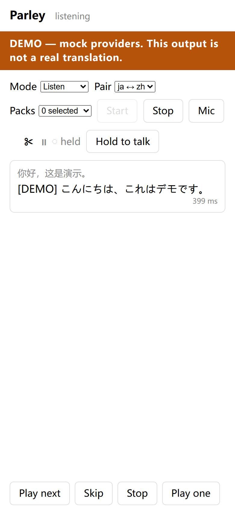
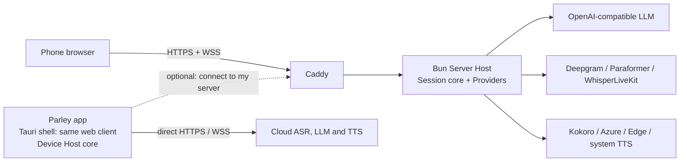

# Parley

**プロンプト駆動、用語集対応、セグメント単位の同時通訳 — スマートフォンでも、完全セルフホストでも。**

[](https://github.com/wray-lee/parley/actions/workflows/ci.yml)
[](LICENSE)


[English](README.md) | [简体中文](README.zh-CN.md) | **日本語**

<p align="center"></p>

<p align="center"><a href="docs/assets/demo.gif">アニメーションデモ（2 秒）</a></p>

Parley は音声を **Segment**（セグメント）に分割し、各 Segment を OpenAI 互換 LLM で **Direction**（方向）のシステムプロンプトとローリングコンテキストを使って翻訳し、確定した Segment を即座に読み上げます。確定済みの出力が書き換えられることはありません。言語とドメイン用語集はコードではなくファイルです。

Parley は Apache-2.0 です。提供形態は 3 つあります:

- セルフホスト可能な **Server Host**（サーバーホスト、Docker Compose またはベアメタル）が配信する **Web アプリ**;
- **Android APK**;
- **iOS IPA**（未署名。サイドロードして使用）。

APK と IPA は同じ Web クライアントを包む薄いシェルです。オーケストレーションコアは **Server Host** 上でも、アプリ内（**Device Host**、デバイスホスト）でも動作します。アプリは自分の Server Host に接続することもできます。

## 機能

- **同時通訳であり、後追い訳ではない。** 各 Segment は処理の途中で翻訳され、確定するとすぐに読み上げられます。原文と訳文は同時に表示され、レイテンシーは Segment ごとに示されます。
- **推測せず、保留する。** 翻訳器は断片に対して **Hold**（`⏸`）を返すことができます。その場合 Segment は待機して次の Segment とマージされ再試行され、2.5 秒後に強制翻訳されます。確定済みの出力が書き換えられることはありません。
- **言語はプロンプトファイル。** `prompts/system_en2fr.txt` をリポジトリに置けば、その Direction が存在します。コードも再ビルドも不要です。
- **スマートフォン優先。** 同じ Web クライアントが、スマートフォンのブラウザ、Android APK、iOS IPA（未署名。サイドロードして使用）で動作します。
- **モデルは持ち込み。** 任意の OpenAI 互換エンドポイント、無料枠の Preset、または完全ローカル構成（WhisperLiveKit + Ollama + Kokoro）。
- **Domain Pack。** 医療、会議、または独自の語彙向けの Session ごとの用語集。
- **キー不要の Demo Mode。** クローン直後の状態で、同梱サンプル上でパイプライン全体が動作し、DEMO と明示されます。
- **Apache-2.0、アカウント不要。** テレメトリーも分析もありません。キーはサーバー上または OS のキーストアに留まります。

**目次:** [クイックスタート](#クイックスタート) · [同時通訳の仕組み](#同時通訳の仕組み) · [アーキテクチャ](#アーキテクチャ) · [Provider Preset](#provider-preset) · [HTTPS と証明書](#https-と証明書) · [Language Pack と Domain Pack](#language-pack-と-domain-pack) · [実測レイテンシー](#実測レイテンシー) · [セキュリティとプライバシー](#セキュリティとプライバシー) · [既知の制限](#既知の制限) · [テスト](#テスト) · [ドキュメント](#ドキュメント) · [コントリビューション](#コントリビューション)

## 同時通訳の仕組み

音声は ASR の **Stable Prefix**（安定プレフィックス）から Segment に切り出されます。Segment が切り出されると、翻訳器は新しいテキストに加えて、その Direction の直近 8 件の確定済み原文／訳文ペアを受け取ります。翻訳器は **Hold**（保留、`⏸`）を返すことがあり、その場合 Segment は待機して次の Segment とマージされ再試行され、2.5 秒後に強制翻訳されます。**Committed**（確定）になった Segment は `seg_id` 順に即座に読み上げられ、二度と改訂されません。

2 つの **Mode**（モード）は **Language Pair**（言語ペア、自分の言語 ↔ 相手の言語）を使用します:

- **Listen**（聞き取り）: Direction は 1 つ（相手→自分）。スマートフォンが外国語の話者を通訳し、字幕（およびイヤホン）で提供します。
- **Converse**（会話）: 明示的な **Turn**（ターン、`me` / `them`）を伴う両方向。自分の発話は翻訳されてスピーカーから再生され、相手の発話は字幕になります。アプリが発話している間はマイクが **Gated**（ゲート制御）され（ゲート付き半二重、ADR-0002）、アプリが自分の声を翻訳することはありません。

言語の追加は `prompts/` にプロンプトファイルを置くだけです。ドメイン用語集は `packs/` 内のタブ区切りファイルです。どちらもコードは不要です。

## アーキテクチャ



- **1 つのコア、2 つのホスト**（[ADR-0001](docs/adr/0001-one-js-core-two-hosts.md)）。`core/` は素の JavaScript ES モジュールです。ビルドステップなし、DOM なし、Node 組み込みモジュールや Bun 専用 API なし（唯一の例外はサーバー専用の Edge TTS アダプターで、アプリでは読み込まれません）。プラットフォーム固有のトランスポートは環境ごとに 1 つのアダプターに収められています。
- **Server Host:** Bun ≥ 1.4、静的 Web クライアント、WebSocket プロトコルブリッジ、HTTPS 用 Caddy。セルフホストのモデルスタック（WhisperLiveKit、Ollama、Kokoro）を置ける唯一の場所です。
- **Device Host:** アプリ内で同じコアを実行し、Provider を直接呼び出し、キーを OS のキーストアに保持し、既定で OS の TTS を使用します。
- **Server Host のブラウザクライアント**はプロトコルクライアントであり、コアを実行せず、サーバーのキーを見ることもありません。
- **Converse** は明示的な Turn を伴うゲート付き半二重です（[ADR-0002](docs/adr/0002-gated-half-duplex-converse.md)）。

## クイックスタート

### 1. Demo Mode（キー不要）

`.env` も Provider 設定もない場合、すべての Provider は `mock` に解決されます。パイプライン全体が同梱サンプル上で動作し、出力には **DEMO** と表示され、アカウントもキーも不要です。

Docker（推奨）:

```sh
git clone https://github.com/wray-lee/parley.git
cd parley
docker compose -f deploy/compose.yaml up -d --build
```

`https://localhost/` を開く（内部 CA の警告を承認する）か、スマートフォンから `https://<server-ip>/` を開きます。**Start** を押すと、同梱の zh→ja サンプルが ASR、翻訳、TTS を通して再生され、DEMO バナーが表示され続けます。`/healthz` は `{"ok":true}` を返します。

ベアメタル（Bun ≥ 1.4）:

```sh
bun install --production --frozen-lockfile
bun run start      # or: bun hosts/node/server.js
                   # http://localhost:3000 — no TLS, so the microphone is unavailable
```

Demo Mode は同梱サンプルを使うため、マイクなしでも動作します。**Mic** は、HTTPS 経由で実際の ASR Provider を使用する場合にのみ押してください。

Demo Mode では、mock ASR は聞いているふりをせず、明確なエラーでライブのマイク音声を拒否します。

### 2. アプリ（APK / IPA）

Demo Mode はキーなしでアプリ内でも動作します。APK をローカルでビルドするには（Windows では WSL、または Linux）:

```sh
bun run build:apk
```

これにより `tmp/parley-<version>-arm64-debug.apk` にデバッグ署名済みの arm64 APK がビルドされます。インストールは `adb install tmp/parley-<version>-arm64-debug.apk` で行います。最初のビルドでは Android ビルダーイメージ（数 GB）をダウンロード／作成するため、Docker が必要です。Windows では既定で WSL ディストロ `arch` を使用します。変更するには `PARLEY_WSL_DISTRO` を設定してください。詳細は [`app/README.md`](app/README.md) を参照してください。

IPA はリリースワークフローが macOS ランナー上で未署名でビルドし（`v*` タグを push するか、Actions → Release を実行）、AltStore/SideStore でインストールします。macOS ジョブはまだ実行されたことがないため、最初の IPA ビルドは未検証とお考えください。リリース署名については [`docs/release.md`](docs/release.md) で説明しています。APK/IPA はアプリストアでは公開されません。

アプリでは、**Settings** ボタンで翻訳 Preset、ASR Provider、TTS Provider を選択し、キーを OS のキーストアに保存します。翻訳／ASR キーがない場合、アプリは DEMO バナーのまま Demo Mode で動作します。

### 3. 実際の Provider を使う Server Host

サンプルの環境ファイルをコピーし、使用する項目だけを記入します:

```sh
cp .env.example .env
```

すべての変数は [`.env.example`](.env.example) に記載されています。Provider の行は意図的にコメントアウトされています。空の値は未設定とは異なるためです。使用する行だけコメントを外してください。

Server Host は翻訳、ASR、TTS のオプションをそのまま渡すため、`DEEPGRAM_API_KEY`、`DASHSCOPE_API_KEY`、`WHISPERLIVEKIT_URL` はアプリと同じライブ ASR Provider を選択します。

```sh
# After editing .env
docker compose -f deploy/compose.yaml up -d --build
```

ドメインを使用する場合は `.env` に `PUBLIC_DOMAIN` を設定し、Compose の変数補間で渡します:

```sh
docker compose -f deploy/compose.yaml --env-file .env up -d --build
```

Let's Encrypt のためには、ポート 80 と 443 がインターネットから到達可能である必要があります。ドメインがない場合、Caddy は内部 CA を使用します。各スマートフォンでそのルート証明書を信頼してください（[HTTPS](#https-と証明書) 参照）。

## Provider Preset

翻訳器は任意の OpenAI 互換エンドポイントです。Preset（プリセット）はベース URL、推奨モデル、データ／リージョンに関する注意事項を提供します。**ユーザーが用意するのはキーだけ**です（`custom` の場合は `LLM_BASE_URL`/`LLM_MODEL` も）。`LLM_PRESET` で選択し、`LLM_API_KEY` を設定してください。

| `LLM_PRESET` | リージョン／到達性 | 無料枠はプロンプトで学習するか | 備考 |
|---|---|---|---|
| `groq`（既定） | グローバル、米国ホスト | いいえ | 高速な無料枠。レート制限あり。 |
| `gemini` | グローバル | **はい（無料枠）** | 機密性の高い会話には有料枠を使用してください。 |
| `siliconflow` | 中国（本土から到達可能） | 未確認 — ありと仮定 | 無料枠の方針は未確認。 |
| `dashscope` | 中国（Alibaba Cloud、本土から到達可能） | 未確認 — ありと仮定 | 無料枠の方針は未確認。 |
| `openrouter` | グローバルルーター | 無料モデルは学習する可能性あり | 有料モデルを選ぶと回避できます。 |
| `ollama` | 自分のマシン | いいえ | キー不要。`LLM_BASE_URL` の既定値は `http://localhost:11434/v1`。 |
| `custom` | 自分のエンドポイント | エンドポイント次第 | `LLM_BASE_URL` が必要。既定モデルがなければ `LLM_MODEL` も設定。 |
| `mistral` | EU（フランス） | 学習する可能性あり（無料枠） | — |
| `deepseek` | 中国（本土から到達可能） | 未確認 — ありと仮定 | — |
| `zhipu` | 中国（本土から到達可能） | 学習する可能性あり（無料モデル枠） | `glm-4-flash`。 |
| `moonshot` | 中国（本土から到達可能） | いいえ | Provider の規約で、プロンプトは学習に使用されないと明記されています。 |
| `cerebras` | グローバル、米国ホスト | いいえ | Provider の規約で、推論データは学習に使用されないと明記されています。 |

無料枠の提供状況、クォータ、モデル ID は頻繁に変わります。この表は **2026 年 10 月**時点（**2026-10** スナップショット）で把握している Preset の内容です。機密性の高い音声を送る前に、各 Provider の最新の規約を確認してください。Preset は [`config/presets.js`](config/presets.js) 内のデータであり、追加にコードは不要です（[CONTRIBUTING](CONTRIBUTING.md) 参照）。

### 追加のリクエストフィールド

OpenAI 互換エンドポイントの中には、標準以外のパラメーターを受け付けるものがあります。`LLM_EXTRA_BODY` に JSON オブジェクトを設定すると、Parley はそれをすべての chat-completions リクエストボディに浅くマージします:

```dotenv
LLM_EXTRA_BODY={"top_k":20}
```

Parley 自身の `model`、`messages`、`stream` フィールドが常に優先されるため、このオブジェクトでそれらを変更することはできません。無効な JSON やオブジェクト以外の値は、翻訳 Provider の作成時に `LLM_EXTRA_BODY` を示すエラーで拒否されます。これは Server Host でのみ設定できます。Device Host のアプリ内設定では公開されていません。

ASR は `ASR_PROVIDER` = `deepgram`（クラウド）、`paraformer`（中国）、`whisperlivekit`（ローカル）、`mock` のいずれかです。TTS は `TTS_PROVIDER` = `system`（OS／ブラウザの音声合成。サーバーから音声は送られません）、`kokoro`、`azure`、`edge`（非公式）、`cosyvoice`（スタブ: 明確なエラーで失敗）、`mock` のいずれかです。

### コピー＆ペースト用レシピ

以下は `.env` の内容です。変数名は `.env.example` と一致します。翻訳、ASR、TTS の値は Server Host とアプリの両方で設定できます。

**クラウド: Deepgram ASR + Groq 翻訳 + Kokoro TTS**

```dotenv
PORT=3000
LLM_PRESET=groq
LLM_API_KEY=<your-groq-key>
ASR_PROVIDER=deepgram
DEEPGRAM_API_KEY=<your-deepgram-key>
TTS_PROVIDER=kokoro
KOKORO_URL=http://127.0.0.1:8880
```

Kokoro はセルフホストです。CPU コンテナを実行し、`KOKORO_URL` をそのコンテナに向けてください:

```sh
docker run -d --name parley-kokoro -p 8880:8880 ghcr.io/remsky/kokoro-fastapi-cpu:v0.9.0
```

**完全ローカル: WhisperLiveKit + Ollama + Kokoro**（音声もテキストもマシン外に出ません）

```dotenv
PORT=3000
LLM_PRESET=ollama
LLM_BASE_URL=http://127.0.0.1:11434/v1
LLM_MODEL=llama3.1
ASR_PROVIDER=whisperlivekit
WHISPERLIVEKIT_URL=ws://127.0.0.1:8000
TTS_PROVIDER=kokoro
KOKORO_URL=http://127.0.0.1:8880
```

Ollama は外部のままです: `ollama serve` と `ollama pull llama3.1` を実行してください。WhisperLiveKit と Kokoro はネットワークサービスです。[`deploy/compose.local.yaml`](deploy/compose.local.yaml) にイメージ、GPU フラグ、フラグ（`--pcm-input --pause-segmentation-seconds 0.7`）の参考情報があり、`local` Compose プロファイルで両方が起動します。WhisperLiveKit の CUDA イメージは上流の v0.2.26 ソースからビルドされ、NVIDIA Container Toolkit を備えた NVIDIA GPU が必要です。

**任意の OpenAI 互換ゲートウェイ**

```dotenv
LLM_PRESET=custom
LLM_BASE_URL=https://gateway.example.com/v1
LLM_MODEL=<model-id>
LLM_API_KEY=<your-key>
ASR_PROVIDER=deepgram
DEEPGRAM_API_KEY=<your-deepgram-key>
TTS_PROVIDER=kokoro
KOKORO_URL=http://127.0.0.1:8880
```

**中国から到達可能: DashScope 翻訳 + Paraformer ASR**

```dotenv
LLM_PRESET=dashscope
LLM_API_KEY=<your-dashscope-key>
ASR_PROVIDER=paraformer
DASHSCOPE_API_KEY=<your-dashscope-key>
TTS_PROVIDER=system
```

北京リージョンの DashScope キーを使用してください。`siliconflow`、`deepseek`、`zhipu`、`moonshot` は、他に本土から到達可能な翻訳 Preset です。`TTS_PROVIDER=system` は OS／ブラウザの音声合成を使用します。Server Host はテキストのみを送信し、ブラウザが `speechSynthesis` で読み上げます。対象言語の音声がインストールされていない場合は、字幕と一度だけの通知を表示します。

これらのレシピは、Server Host がループバック上でサイドカーに到達できることを前提としています。Compose 内では代わりに `local` プロファイルのサービス名を使用してください（`ws://whisperlivekit:8000`、`http://kokoro:8880`）。ローカルのサイドカーはリポジトリのルートから起動します:

```sh
docker compose -f deploy/compose.yaml -f deploy/compose.local.yaml --profile local up -d
```

## HTTPS と証明書

マイクにはセキュアコンテキストが必要です。Compose 構成では常に Caddy 経由で HTTPS を配信します。

- **ドメインなし（既定）:** Caddy は内部 CA を使用します。これをエクスポートし、各スマートフォンで信頼してください:

  ```sh
  docker compose -f deploy/compose.yaml cp caddy:/data/caddy/pki/authorities/local/root.crt ./root.crt
  ```

  - **iOS/iPadOS:** プロファイルをインストールし、設定 → 一般 → 情報 → 証明書信頼設定 → Parley ルート証明書の完全な信頼を有効にします。
  - **Android:** 設定 → セキュリティ → 暗号化と認証情報 → 証明書のインストール → CA 証明書。
  - **デスクトップ:** `root.crt` を OS／ブラウザの信頼ストアにインポートします。

- **ドメインあり:** `.env` に `PUBLIC_DOMAIN=parley.example.com` を設定し、`--env-file .env` を付けて起動します。Caddy が Let's Encrypt 証明書を取得して更新します。ポート 80 と 443 が到達可能である必要があります。

- **CA の代わりにトンネル:** Bun ホストをループバックで実行し、`tailscale serve --bg 3000` または `cloudflared tunnel --url http://127.0.0.1:3000` を使用します。どちらも公的に信頼された証明書で TLS を終端します。

デプロイの詳細、ベアメタルでのプロキシ、注意事項は [`deploy/README.md`](deploy/README.md) にあります。

## Language Pack と Domain Pack

コードは不要です。

- **Language Pack（Direction を追加）:** `prompts/system_{src}2{tgt}.txt` を作成します。例: `prompts/system_en2fr.txt`。1 つのファイルがちょうど 1 つの Direction を定義します。Language Pair は自動的に導出されます。両方向（`en2fr` と `fr2en`）が揃えば Listen と Converse の両方でそのペアを利用でき、片方向だけなら Listen 専用になります。
- **任意のベース Glossary（用語集）:** `prompts/glossary_{src}2{tgt}.tsv`。タブ区切りの 2 列（`source term`、`target term`）。
- **Domain Pack:** `packs/{name}_{src}2{tgt}.tsv`。例: `packs/medical_en2fr.tsv`。タブ区切りの 2 列。Pack は Session ごとに選択され、既定では無効です。選択した Pack は、同じ原語項目に対するベース Glossary の項目を上書きします。

言語コードは不透明な文字列であり、`core/` 内で特定の言語によって分岐する箇所はありません。言語ごとの節（clause）チューニングは [`config/pairs.json`](config/pairs.json) にあります（任意。ない場合は既定値が適用されます）。4 つのプロンプトマーカー、用語集プレースホルダー、注釈付き zh↔ja テンプレート、TSV ルール、セルフテストチェックリストは [`CONTRIBUTING.md`](CONTRIBUTING.md) にあります。

Server Host はベース Glossary とすべての Domain Pack を読み込み、選択された Pack を各翻訳リクエストに挿入します。Pack の項目は、同じ原語項目を持つベース Glossary の項目を上書きします。

zh↔ja の Language Pack と会議用 Domain Pack は凍結された製品資産です。文言を変更しないでください。変更が必要な場合は新しいファイルを追加してください。

## 実測レイテンシー

Kokoro-FastAPI v0.9.0 CPU（`ghcr.io/remsky/kokoro-fastapi-cpu`）、WSL2、2026-10-28、直接 HTTP:

| 対象 | 音声 | オーディオ | 合計 | 先頭バイト |
|---|---|---|---|---|
| 日本語 | `jf_alpha` | 39,212 B mp3 | 0.613 s | 0.009 s |
| 中国語 | `zf_xiaobei` | 40,364 B mp3 | 1.267 s | 0.009 s |

実際の Server Host 経由では、`tts_first_chunk - first_token` は 603 ms でした。文の長さやハードウェアによってこの数値は変わります。これは参考値であり、保証ではありません。

## テスト

```sh
bun test                      # all tests
bun run lint                  # zero-dependency syntax check
bun scripts/demo-smoke.mjs    # keyless Demo Mode over the real Server Host
```

CI は push と pull request のたびに同じチェックを実行します。テストのシームと方針は [CONTRIBUTING.md](CONTRIBUTING.md#testing-policy-two-seams) で説明しています。

## セキュリティとプライバシー

- **テレメトリー、分析、アカウントはありません。** Parley は使用状況をどこにも報告しません。外向きの呼び出しは、設定した Provider へのものだけです。
- **キーがブラウザに渡ることはありません。** Server Host ではキーは `.env`（環境変数）に保持され、サーバー側で使用されます。
- **デバイス上のキーは OS のキーストアに保持されます。** アプリはシークレットを安全なキーストアプラグイン経由でのみ書き込みます。WebView ストレージに入るのは非シークレットの選択肢のみです。キーストアが利用できない場合、キーはセッションメモリのみに保持され、終了時に失われます。
- **Access Token（アクセストークン）:** `ACCESS_TOKEN` は任意の共有パスフレーズ 1 つで、アカウントではありません。設定すると、`/ws` ハンドシェイクは `?token=` の欠落または誤りを HTTP 401 で拒否します。Web クライアントはタブごとに 1 回入力を求め、トークンは `sessionStorage` にのみ保持します。

## 既知の制限

- スピーカー出力は 1 Segment 分遅れます。通訳は準同時通訳であり、逐語訳ではありません。
- 遠距離からの講義音声の収音には物理的な限界があります。マイクを近づけると ASR の精度が大幅に向上します。
- スマートフォン上の Converse はゲート付き半二重（[ADR-0002](docs/adr/0002-gated-half-duplex-converse.md)）であり、エコーキャンセル付きの全二重ではありません。
- CosyVoice はスタブです。選択すると明確な「not implemented」エラーで失敗します。
- Kokoro の zh/ja 音声は中程度の品質です（中国語はモデルカードで D 評価）。
- CPU 上の WhisperLiveKit は zh/ja に弱いです。GPU イメージはダウンロード約 8 GB とされていますが、ローカルビルドではディスク上で非圧縮約 22 GB と計測されました。NVIDIA GPU が必要です。
- Edge TTS は非公式にリバースエンジニアリングされたサービスであり、予告なく使えなくなる可能性があります。
- Gemini の無料枠はプロンプトで学習します。無料枠の制限とモデル ID は頻繁に変わります。
- System TTS はブラウザにインストールされた音声に依存します。対象言語に一致する音声がない場合は、一度だけの通知と字幕のみを表示します。
- 2.5 秒のレイテンシー目標は、翻訳器の先頭トークン遅延に依存します。推論モデルを中程度の effort（推論の強さ）で使用した場合（`LLM_EXTRA_BODY` で設定）、ライブ実行では約 70% の Segment がこの目標を満たしました（中央値 2.1 秒。未達は 2.7〜9.8 秒で、すべて LLM ステージ由来）。低い effort は高速ですが `⏸` をスキップし、推論が出力に漏れました。高い effort は遅すぎます。すべての Segment で 2.5 秒を満たす必要がある場合は、非推論モデルを使用してください。
- コールドスタートはこの目標に含まれません。`docker compose up` 後の最初の Segment は WhisperLiveKit または Ollama の読み込みに約 30 秒かかることがあります（実測 29.9 秒、1 リクエストは 30 秒でタイムアウト）。使い捨ての Segment で 1 回ウォームアップするか、2 番目の Segment から判断してください。
- ローカルの zh→ja 認識は、同梱の WhisperLiveKit v0.2.26 `large-v3` イメージと compose フラグで動作します。`small` モデルや WhisperLiveKit 自身の翻訳フラグを使うと、代わりに英語が返ることがあります。WhisperLiveKit 側の翻訳は決して有効にしないでください。
- **実機での検証はまだです。** スマートフォンへのインストールと端末上のチェックは未実施で、署名なし IPA の macOS ビルドもまだ実行していません。
- `bun run build:apk` で生成される APK はデバッグ署名済みで arm64 専用です。IPA は未署名です。アプリストアでの公開はありません。
- 言語の自動検出、話者ダイアライゼーション、アカウント、決済、分析はスコープ外です。

## ドキュメント

- [用語集](CONTEXT.md)
- アーキテクチャ決定: [1 つの JS コア、2 つのホスト](docs/adr/0001-one-js-core-two-hosts.md)、[ゲート付き半二重の Converse](docs/adr/0002-gated-half-duplex-converse.md)
- [アプリのビルド](app/README.md)
- [サーバーデプロイ](deploy/README.md)
- [リリース](docs/release.md)
- [サードパーティ通知](docs/third-party-notices.md)

## コントリビューション

CLA はありません。コントリビューションは Apache-2.0 の下で受け入れられます。新しい Language Pack、Domain Pack、Preset、Provider アダプターについては、**まず issue を開いてください**。作成前に命名とスコープを合意するためです。PolyTalk や AGPL/GPL/LGPL プロジェクトからコードをコピーしないでください。

ファイル形式、命名、プロンプトプロトコル、注釈付き zh↔ja テンプレート、セルフテスト、Provider アダプターテンプレートについては [`CONTRIBUTING.md`](CONTRIBUTING.md) を参照してください。

CI は push と pull request のたびに `bun run lint`、`bun test`、キー不要のデモスモークを実行します。

## ライセンス

Apache License 2.0 — [`LICENSE`](LICENSE) を参照してください。同梱のサードパーティコンポーネントは [`docs/third-party-notices.md`](docs/third-party-notices.md) に記載されています。サンプル音声とトランスクリプトは CC0 で、Apache-2.0 の Kokoro-82M 重みを使用して生成されました。
