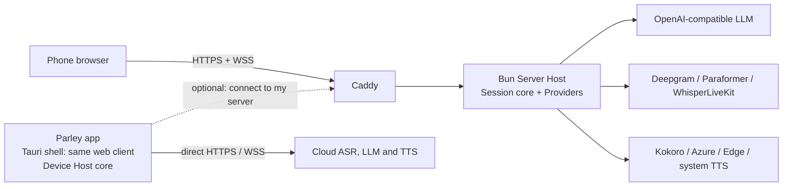

# Parley

**Segment-by-segment simultaneous interpretation — prompt-driven, glossary-aware, on a phone or fully self-hosted.**

[](https://github.com/wray-lee/parley/actions/workflows/ci.yml)
[](LICENSE)


**English** | [简体中文](README.zh-CN.md) | [日本語](README.ja.md)

<p align="center"></p>

<p align="center"><a href="docs/assets/demo.gif">Animated demo (2 s)</a></p>

Parley turns speech into **Segments**, translates each Segment with an OpenAI-compatible LLM using the **Direction**'s system prompt and a rolling context, and speaks the committed Segment immediately. Committed output is never rewritten. Languages and domain glossaries are files, not code.

Parley is Apache-2.0 and ships three ways:

- a **web app** served by a self-hostable **Server Host** (Docker Compose or bare metal);
- an **Android APK**;
- an **iOS IPA** (unsigned; sideload it).

The APK and IPA are thin shells around the same web client. The orchestration core runs either in the **Server Host** or in the app (**Device Host**). The app can also connect to your own Server Host.

## Features

- **Simultaneous, not after-the-fact.** Each Segment is translated in flight and spoken as soon as it is committed; source and translation appear together, with latency shown per Segment.
- **Hold instead of guessing.** The translator can answer **Hold** (`⏸`) on a fragment; the Segment waits, merges with the next one and retries, then is force-translated after 2.5 s. Committed output is never rewritten.
- **Languages are prompt files.** Drop `prompts/system_en2fr.txt` into the repo and the Direction exists: no code, no rebuild.
- **Phone-first.** The same web client runs in a phone browser, an Android APK and an iOS IPA (unsigned; sideload it).
- **Bring your own model.** Any OpenAI-compatible endpoint, a free-tier Preset, or a fully local stack (WhisperLiveKit + Ollama + Kokoro).
- **Domain Packs.** Per-Session glossaries for medical, conference or your own vocabulary.
- **Keyless Demo Mode.** A fresh clone runs the whole pipeline on a bundled sample, clearly labelled DEMO.
- **Apache-2.0, no accounts.** No telemetry or analytics; keys stay on the server or in the OS keystore.

**Contents:** [Quick start](#quick-start) · [How interpretation works](#how-interpretation-works) · [Architecture](#architecture) · [Provider Presets](#provider-presets) · [HTTPS](#https-and-certificates) · [Language and Domain Packs](#language-packs-and-domain-packs) · [Measured latency](#measured-latency) · [Security and privacy](#security-and-privacy) · [Known limits](#known-limits) · [Testing](#testing) · [Documentation](#documentation) · [Contributing](#contributing)

## How interpretation works

Speech is cut into Segments from the ASR's **Stable Prefix**. When a Segment is cut, the translator receives the new text plus the last 8 committed source/translation pairs for that Direction. It may answer **Hold** (`⏸`); the Segment then waits, merges with the next one and retries, and is force-translated after 2.5 s. Once **Committed**, a Segment is spoken immediately in `seg_id` order and is never revised.

Two **Modes** use a **Language Pair** (my language ↔ their language):

- **Listen:** one Direction (their→mine). The phone interprets a foreign speaker into subtitles (and earphones).
- **Converse:** both Directions with explicit **Turns** (`me` / `them`). Your speech is translated and played through the loudspeaker; theirs becomes subtitles. The microphone is **Gated** while the app speaks (gated half-duplex, ADR-0002), so the app never translates its own voice.

A language is added by dropping a prompt file into `prompts/`. A domain glossary is a tab-separated file in `packs/`. Neither needs code.

## Architecture



- **One core, two hosts** ([ADR-0001](docs/adr/0001-one-js-core-two-hosts.md)). `core/` is plain JavaScript ES modules: no build step, no DOM, no Node built-ins or Bun-only APIs (the one exception is the server-only Edge TTS adapter, which the app never loads). Platform transport lives in one adapter per environment.
- **Server Host:** Bun ≥ 1.4, static web client, WebSocket protocol bridge, Caddy for HTTPS. It is the only home for the self-hosted model stack (WhisperLiveKit, Ollama, Kokoro).
- **Device Host:** runs the same core inside the app, calls Providers directly, keeps keys in the OS keystore and defaults to the OS TTS.
- **Browser client of a Server Host** is a protocol client; it never runs the core and never sees server keys.
- **Converse** is gated half-duplex with explicit Turns ([ADR-0002](docs/adr/0002-gated-half-duplex-converse.md)).

## Quick start

### 1. Demo Mode (no keys)

With no `.env` and no Provider settings, every Provider resolves to `mock`: the whole pipeline runs on a bundled sample, output is labelled **DEMO**, and no account or key is needed.

Docker (recommended):

```sh
git clone https://github.com/wray-lee/parley.git
cd parley
docker compose -f deploy/compose.yaml up -d --build
```

Open `https://localhost/` (accept the internal-CA warning) or `https://<server-ip>/` from a phone. Press **Start**: the bundled zh→ja sample plays through ASR, translation and TTS, and the DEMO banner stays visible. `/healthz` answers `{"ok":true}`.

Bare metal (Bun ≥ 1.4):

```sh
bun install --production --frozen-lockfile
bun run start      # or: bun hosts/node/server.js
                   # http://localhost:3000 — no TLS, so the microphone is unavailable
```

Demo Mode uses the bundled sample, so it works without a microphone. Press **Mic** only with a real ASR Provider over HTTPS.

In Demo Mode the mock ASR refuses live microphone audio with a clear error instead of pretending to listen.

### 2. App (APK / IPA)

Demo Mode works in the app with no keys. To build the APK locally (WSL on Windows, or Linux):

```sh
bun run build:apk
```

This builds a debug-signed arm64 APK at `tmp/parley-<version>-arm64-debug.apk`; install it with `adb install tmp/parley-<version>-arm64-debug.apk`. The first build downloads/creates the Android builder image (several GB) and needs Docker. On Windows it uses the WSL distro `arch` by default; set `PARLEY_WSL_DISTRO` to override. See [`app/README.md`](app/README.md).

The IPA is built unsigned on a macOS runner by the release workflow (push a `v*` tag, or run Actions → Release) and is installed with AltStore/SideStore. The macOS job has not yet been exercised, so treat the first IPA build as unverified. Release signing is covered in [`docs/release.md`](docs/release.md). The APK/IPA are not published to an app store.

In the app, the **Settings** button picks the translator Preset, ASR Provider and TTS Provider, and stores keys in the OS keystore. Translator options also include a **Base URL** override (required for `custom`, which also needs a **Model**), a **Model** override for any Preset, and **Extra request fields (JSON)** with the same rules as `LLM_EXTRA_BODY`. Plain-http Base URLs are limited to loopback and private LAN IPv4 addresses; other hosts need https. On Android 17+, saving a LAN URL asks for the Nearby devices permission (`ACCESS_LOCAL_NETWORK`); denial keeps the error in the settings dialog, and `localhost` needs no grant. With no translator/ASR key, the app stays in Demo Mode with the DEMO banner.

### 3. Server Host with real Providers

Copy the example environment file and fill in only what you use:

```sh
cp .env.example .env
```

Every variable is documented in [`.env.example`](.env.example). Provider lines are commented out on purpose: an empty value is not the same as an unset one. Uncomment the ones you use.

The Server Host passes translator, ASR and TTS options through, so `DEEPGRAM_API_KEY`, `DASHSCOPE_API_KEY` and `WHISPERLIVEKIT_URL` select the same live ASR providers the app uses.

```sh
# After editing .env
docker compose -f deploy/compose.yaml up -d --build
```

For a domain, set `PUBLIC_DOMAIN` in `.env` and pass it to Compose interpolation:

```sh
docker compose -f deploy/compose.yaml --env-file .env up -d --build
```

Ports 80 and 443 must be reachable from the internet for Let's Encrypt. Without a domain Caddy uses its internal CA; trust its root certificate on each phone (see [HTTPS](#https-and-certificates)).

## Provider Presets

The translator is any OpenAI-compatible endpoint. A Preset supplies the base URL, a recommended model and its data/region notes; **you supply only the key** (plus `LLM_BASE_URL`/`LLM_MODEL` for `custom`). Choose one with `LLM_PRESET` and set `LLM_API_KEY`.

| `LLM_PRESET` | Region / reachability | Free tier trains on prompts? | Notes |
|---|---|---|---|
| `groq` (default) | Global, US-hosted | No | Fast free tier with rate limits. |
| `gemini` | Global | **Yes, on the free tier** | Use a paid tier for confidential talks. |
| `siliconflow` | China (mainland-reachable) | Unverified — assume yes | Free-tier policy not verified. |
| `dashscope` | China (Alibaba Cloud, mainland-reachable) | Unverified — assume yes | Free-quota policy not verified. |
| `openrouter` | Global router | Free models may | Pick a paid model to opt out. |
| `ollama` | Your machine | No | No key; `LLM_BASE_URL` defaults to `http://localhost:11434/v1`. |
| `custom` | Your endpoint | Depends on the endpoint | Requires `LLM_BASE_URL` and `LLM_MODEL`. |
| `mistral` | EU (France) | May train (free tier) | — |
| `deepseek` | China (mainland-reachable) | Unverified — assume yes | — |
| `zhipu` | China (mainland-reachable) | May train (free model tier) | `glm-4-flash`. |
| `moonshot` | China (mainland-reachable) | No | Provider terms state prompts are not used for training. |
| `cerebras` | Global, US-hosted | No | Provider terms state inference data is not used for training. |

Free-tier availability, quotas and model IDs change often; the table describes the Presets as understood in **October 2026** (**2026-10** snapshot). Check each Provider's current terms before sending confidential speech. Presets are data in [`config/presets.json`](config/presets.json); adding one needs no code (see [CONTRIBUTING](CONTRIBUTING.md)).

### Extra request fields

Some OpenAI-compatible endpoints take parameters beyond the standard ones. Set `LLM_EXTRA_BODY` to a JSON object and Parley shallow-merges it into every chat-completions request body:

```dotenv
LLM_EXTRA_BODY={"top_k":20}
```

Parley's own `model`, `messages` and `stream` fields always win, so the object cannot change them. Invalid JSON or a non-object is rejected with an error naming `LLM_EXTRA_BODY` when the translator Provider is created. Set `LLM_EXTRA_BODY` on the Server Host, or **Extra request fields (JSON)** in the app's Settings; both accept only a JSON object and merge identically.

ASR is `ASR_PROVIDER` = `deepgram` (cloud), `paraformer` (China), `whisperlivekit` (local) or `mock`. TTS is `TTS_PROVIDER` = `system` (OS/browser speech, no audio from the server), `kokoro`, `azure`, `edge` (unofficial), `cosyvoice` (stub: fails with a clear error) or `mock`.

### Copy-paste recipes

These are `.env` contents. Variable names match `.env.example`. Translator, ASR and TTS values are wired on the Server Host and in the app.

**Cloud: Deepgram ASR + Groq translator + Kokoro TTS**

```dotenv
PORT=3000
LLM_PRESET=groq
LLM_API_KEY=<your-groq-key>
ASR_PROVIDER=deepgram
DEEPGRAM_API_KEY=<your-deepgram-key>
TTS_PROVIDER=kokoro
KOKORO_URL=http://127.0.0.1:8880
```

Kokoro is self-hosted; run the CPU container and point `KOKORO_URL` at it:

```sh
docker run -d --name parley-kokoro -p 8880:8880 ghcr.io/remsky/kokoro-fastapi-cpu:v0.9.0
```

**Full local: WhisperLiveKit + Ollama + Kokoro** (no audio or text leaves the machine)

```dotenv
PORT=3000
LLM_PRESET=ollama
LLM_BASE_URL=http://127.0.0.1:11434/v1
LLM_MODEL=llama3.1
ASR_PROVIDER=whisperlivekit
WHISPERLIVEKIT_URL=ws://127.0.0.1:8000
TTS_PROVIDER=kokoro
KOKORO_URL=http://127.0.0.1:8880
```

Ollama stays external: `ollama serve` and `ollama pull llama3.1`. WhisperLiveKit and Kokoro are network services; [`deploy/compose.local.yaml`](deploy/compose.local.yaml) is the reference for their images, GPU flags and flags (`--pcm-input --pause-segmentation-seconds 0.7`), and the `local` Compose profile starts both. The WhisperLiveKit CUDA image is built from the upstream v0.2.26 source and needs an NVIDIA GPU with the NVIDIA Container Toolkit.

**Any OpenAI-compatible gateway**

```dotenv
LLM_PRESET=custom
LLM_BASE_URL=https://gateway.example.com/v1
LLM_MODEL=<model-id>
LLM_API_KEY=<your-key>
ASR_PROVIDER=deepgram
DEEPGRAM_API_KEY=<your-deepgram-key>
TTS_PROVIDER=kokoro
KOKORO_URL=http://127.0.0.1:8880
```

**China-reachable: DashScope translator + Paraformer ASR**

```dotenv
LLM_PRESET=dashscope
LLM_API_KEY=<your-dashscope-key>
ASR_PROVIDER=paraformer
DASHSCOPE_API_KEY=<your-dashscope-key>
TTS_PROVIDER=system
```

Use a Beijing-region DashScope key. `siliconflow`, `deepseek`, `zhipu` and `moonshot` are the other mainland-reachable translator Presets. `TTS_PROVIDER=system` uses OS/browser speech: the Server Host sends text only and the browser speaks it with `speechSynthesis`; if no voice for the target language is installed it shows subtitles and a one-time notice instead.

The recipes assume the Server Host can reach the sidecars on loopback. Inside Compose, use the service names from the `local` profile instead (`ws://whisperlivekit:8000`, `http://kokoro:8880`). Start the local sidecars from the repository root:

```sh
docker compose -f deploy/compose.yaml -f deploy/compose.local.yaml --profile local up -d
```

## HTTPS and certificates

Microphones require a secure context. The Compose setup always serves HTTPS through Caddy.

- **No domain (default):** Caddy uses an internal CA. Export it and trust it on each phone:

  ```sh
  docker compose -f deploy/compose.yaml cp caddy:/data/caddy/pki/authorities/local/root.crt ./root.crt
  ```

  - **iOS/iPadOS:** install the profile, then Settings → General → About → Certificate Trust Settings → enable full trust for the Parley root.
  - **Android:** Settings → Security → Encryption & credentials → Install a certificate → CA certificate.
  - **Desktop:** import `root.crt` into the OS/browser trust store.

- **Domain:** set `PUBLIC_DOMAIN=parley.example.com` in `.env` and start with `--env-file .env`; Caddy obtains and renews a Let's Encrypt certificate. Ports 80 and 443 must be reachable.

- **Tunnels instead of a CA:** run the Bun host on loopback and use `tailscale serve --bg 3000`, or `cloudflared tunnel --url http://127.0.0.1:3000`. Both terminate TLS with a publicly trusted certificate.

Full deployment details, bare-metal proxying and caveats are in [`deploy/README.md`](deploy/README.md).

## Language Packs and Domain Packs

No code is required.

- **Language Pack (adds a Direction):** create `prompts/system_{src}2{tgt}.txt`, for example `prompts/system_en2fr.txt`. One file defines exactly one Direction. A Language Pair is derived automatically: both Directions (`en2fr` and `fr2en`) make the pair available in Listen and Converse; one Direction makes it listen-only.
- **Optional base Glossary:** `prompts/glossary_{src}2{tgt}.tsv`, two tab-separated columns (`source term`, `target term`).
- **Domain Pack:** `packs/{name}_{src}2{tgt}.tsv`, for example `packs/medical_en2fr.tsv`. Two tab-separated columns. Packs are selected per Session and are off by default; a selected Pack overrides a base Glossary entry for the same source term.

Language codes are opaque strings; nothing in `core/` branches on a particular language. Per-language clause tuning lives in [`config/pairs.json`](config/pairs.json) (optional; defaults apply otherwise). The four prompt markers, glossary placeholder, annotated zh↔ja template, TSV rules and a self-test checklist are in [`CONTRIBUTING.md`](CONTRIBUTING.md).

The Server Host loads base Glossaries and every Domain Pack, and injects the selected Packs into each translator request. A Pack entry overrides a base Glossary entry with the same source term.

The zh↔ja Language Packs and conference Domain Packs are frozen product assets: never reword them. Add new files instead.

## Measured latency

Kokoro-FastAPI v0.9.0 CPU (`ghcr.io/remsky/kokoro-fastapi-cpu`), WSL2, 2026-10-28, direct HTTP:

| Target | Voice | Audio | Total | First byte |
|---|---|---|---|---|
| Japanese | `jf_alpha` | 39,212 B mp3 | 0.613 s | 0.009 s |
| Chinese | `zf_xiaobei` | 40,364 B mp3 | 1.267 s | 0.009 s |

Through the real Server Host, `tts_first_chunk - first_token` was 603 ms. Sentence lengths and hardware change these numbers; they are a reference point, not a guarantee.

## Testing

```sh
bun test                      # all tests
bun run lint                  # zero-dependency syntax check
bun scripts/demo-smoke.mjs    # keyless Demo Mode over the real Server Host
```

CI runs the same checks on every push and pull request. Test seams and policy are described in [CONTRIBUTING.md](CONTRIBUTING.md#testing-policy-two-seams).

## Security and privacy

- **No telemetry, analytics or accounts.** Parley does not report usage anywhere. The only outbound calls are the Providers you configure.
- **Keys never reach the browser.** On the Server Host they stay in `.env` (environment variables) and are used server-side.
- **Keys stay in the OS keystore on the device.** The app writes secrets only through the secure-keystore plugin; non-secret choices are the only values in WebView storage. If the keystore is unavailable, keys fall back to session memory only and are lost on exit.
- **Access Token:** `ACCESS_TOKEN` is one optional shared passphrase, not an account. When set, the `/ws` handshake rejects a missing or wrong `?token=` with HTTP 401; the web client prompts once per tab and keeps the token in `sessionStorage` only.

## Known limits

- Loudspeaker output lags by one Segment: interpretation is quasi-simultaneous, not word-by-word.
- Far-field lecture pickup is physically limited; a close microphone gives much better ASR.
- Converse is gated half-duplex on phones ([ADR-0002](docs/adr/0002-gated-half-duplex-converse.md)), not full-duplex with echo cancellation.
- CosyVoice is a stub: selecting it fails with a clear "not implemented" error.
- Kokoro's zh/ja voices are mid-quality (Chinese is graded D in the model card).
- WhisperLiveKit on CPU is weak for zh/ja. The GPU image is specified as ≈8 GB to download; the local build measured ≈22 GB uncompressed on disk. It needs an NVIDIA GPU.
- Edge TTS is an unofficial, reverse-engineered service; it can break without notice.
- Gemini's free tier trains on prompts; free-tier limits and model IDs change often.
- System TTS depends on a voice installed in the browser; when none matches the target language it shows a one-time notice and subtitles only.
- The 2.5 s latency target depends on the translator's first-token latency. With a reasoning model at medium effort (set via `LLM_EXTRA_BODY`), live runs met it for ~70% of Segments (median 2.1 s; misses 2.7–9.8 s, all from the LLM stage). Low effort is faster but skipped `⏸` and leaked reasoning; high effort is too slow. Use a non-reasoning model if every Segment must meet 2.5 s.
- Cold start is not part of that target: the first Segment after `docker compose up` can spend ~30 s loading WhisperLiveKit or Ollama (measured 29.9 s, one request timed out at 30 s). Prewarm with one throwaway Segment, or judge from the second Segment.
- Local zh→ja recognition works with the shipped WhisperLiveKit v0.2.26 `large-v3` image and compose flags; a `small` model or WhisperLiveKit's own translation flags can return English instead. Never enable WhisperLiveKit-side translation.
- **Not yet verified on real phones.** Phone installation and on-device checks are still pending, and the unsigned IPA macOS build has not been exercised.
- The APK from `bun run build:apk` is debug-signed and arm64-only; the IPA is unsigned. No app-store publishing.
- Language auto-detection beyond the Language Pair, speaker diarization, accounts, payments and analytics are out of scope. Converse in v0.0.x is manual-only; v0.1 adds Auto Turn only when the ASR Provider reports pair-capable language tags ([ADR-0003](docs/adr/0003-flutter-clients-and-one-go-core.md)).

## Documentation

- [Vocabulary](CONTEXT.md)
- Architecture decisions: [one JS core, two hosts](docs/adr/0001-one-js-core-two-hosts.md), [gated half-duplex Converse](docs/adr/0002-gated-half-duplex-converse.md)
- [App build](app/README.md)
- [Server deployment](deploy/README.md)
- [Releases](docs/release.md)
- [Third-party notices](docs/third-party-notices.md)

## Contributing

No CLA. Contributions are accepted under Apache-2.0. **Open an issue first** for a new Language Pack, Domain Pack, Preset or Provider adapter so naming and scope can be agreed before you write it. Never copy code from PolyTalk or any AGPL/GPL/LGPL project.

See [`CONTRIBUTING.md`](CONTRIBUTING.md) for file formats, naming, the prompt protocol, the zh↔ja annotated template, self-tests and the Provider adapter template.

CI runs `bun run lint`, `bun test` and the keyless demo smoke on every push and pull request.

## License

Apache License 2.0 — see [`LICENSE`](LICENSE). Bundled third-party components are listed in [`docs/third-party-notices.md`](docs/third-party-notices.md); sample audio and transcripts are CC0, generated with Apache-2.0 Kokoro-82M weights.
