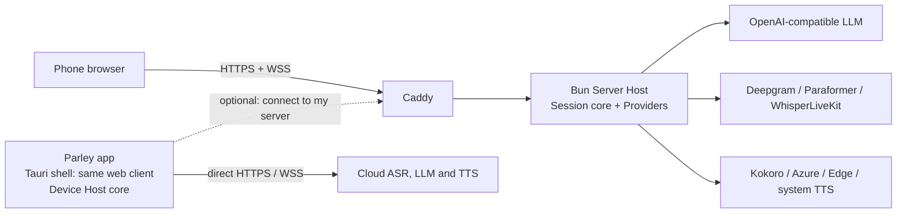

# Parley

**逐段进行的同声传译 —— 提示词驱动、术语表感知，可运行在手机上，也可完全自托管。**

[](https://github.com/wray-lee/parley/actions/workflows/ci.yml)
[](LICENSE)


[English](README.md) | **简体中文** | [日本語](README.ja.md)

<p align="center"></p>

<p align="center"><a href="docs/assets/demo.gif">动态演示（2 s）</a></p>

Parley 将语音切成 **Segment（语音段）**，使用 **Direction（方向）** 的系统提示词和 **Rolling Context（滚动上下文）**，通过 OpenAI 兼容的 LLM 翻译每个 Segment，并立即朗读已提交的 Segment。已提交的输出永不改写。语言和领域 **Glossary（术语表）** 都是文件，而不是代码。

Parley 采用 Apache-2.0 许可证，提供三种交付方式：

- 由可自托管的 **Server Host（服务器宿主）** 提供服务的 **Web 应用**（Docker Compose 或裸机）；
- **Android APK**；
- **iOS IPA**（未签名；需侧载）。

APK 和 IPA 只是同一 Web 客户端的薄壳。编排核心既可在 **Server Host** 中运行，也可在 App 内运行（**Device Host（设备宿主）**）。App 也可以连接你自己的 Server Host。

## 功能特性

- **同声传译，而非事后翻译。** 每个 Segment 都在传输过程中翻译，并在提交后立即朗读；原文与译文同时出现，并显示每个 Segment 的延迟。
- **宁可 Hold，也不猜测。** 翻译器可以对一个片段回答 **Hold**（`⏸`）；该 Segment 会等待、与下一段合并后重试，并在 2.5 s 后强制翻译。已提交的输出永不改写。
- **语言即提示词文件。** 把 `prompts/system_en2fr.txt` 放进仓库，这个 Direction 就存在了：无需写代码，无需重新构建。
- **手机优先。** 同一个 Web 客户端可运行在手机浏览器、Android APK 和 iOS IPA 中（未签名；需侧载）。
- **自带模型。** 任何 OpenAI 兼容端点、免费层 Preset，或完全本地的模型栈（WhisperLiveKit + Ollama + Kokoro）。
- **Domain Pack（领域包）。** 按 Session 使用的术语表，适用于医疗、会议或你自己的词汇。
- **无需 Key 的 Demo Mode（演示模式）。** 全新克隆即可用内置样例跑完整个流水线，并明确标注 DEMO。
- **Apache-2.0，无需账号。** 没有遥测或统计分析；Key 保留在服务器上或操作系统钥匙串中。

**目录：** [快速开始](#快速开始) · [工作原理](#工作原理) · [架构](#架构) · [Provider Presets](#provider-presets提供商预设) · [HTTPS](#https-与证书) · [语言包与领域包](#language-pack语言包与-domain-pack领域包) · [实测延迟](#实测延迟) · [安全与隐私](#安全与隐私) · [已知限制](#已知限制) · [测试](#测试) · [文档](#文档) · [贡献](#贡献)

## 工作原理

语音依据 ASR 的 **Stable Prefix（稳定前缀）** 切成 Segment。当某个 Segment 被切分时，翻译器会收到新文本，以及该 Direction 最近 8 条已提交的原文/译文对。翻译器可以回答 **Hold（保持）**（`⏸`）；此时该 Segment 会等待，与下一段合并后重试，并在 2.5 s 后强制翻译。一旦 **Committed（已提交）**，Segment 会按 `seg_id` 顺序立即朗读，且永不修订。

两种 **Mode（模式）** 都使用一个 **Language Pair（语言对）**（我的语言 ↔ 对方语言）：

- **Listen（聆听）：** 只有一个 Direction（对方→我）。手机把外语说话人的话转成字幕（以及耳机中的音频）。
- **Converse（对话）：** 两个 Direction，并带有明确的 **Turn（轮次）**（`me` / `them`）。你的话会被翻译并通过扬声器播放；对方的话变成字幕。App 说话期间麦克风处于 **Gated（门控）** 状态（门控半双工，ADR-0002），因此 App 永远不会翻译自己的声音。

新增一种语言，只需把提示词文件放进 `prompts/`。领域术语表是 `packs/` 中的制表符分隔文件。两者都不需要写代码。

## 架构



- **一个核心，两种宿主**（[ADR-0001](docs/adr/0001-one-js-core-two-hosts.md)）。`core/` 是纯 JavaScript ES 模块：没有构建步骤、没有 DOM、不使用 Node 内置模块或 Bun 专属 API（唯一例外是仅在服务端使用的 Edge TTS 适配器，App 不会加载它）。传输层按运行环境各有一个适配器。
- **Server Host：** Bun ≥ 1.4、静态 Web 客户端、WebSocket 协议桥，由 Caddy 提供 HTTPS。它是自托管模型栈（WhisperLiveKit、Ollama、Kokoro）的唯一运行环境。
- **Device Host：** 在 App 内运行同一核心，直接调用 Provider（提供商），把 Key 保存在操作系统钥匙串中，并默认使用系统 TTS。
- **Server Host 的浏览器客户端**是协议客户端；它从不运行核心，也永远不会看到服务端 Key。
- **Converse** 采用带显式 Turn 的门控半双工（[ADR-0002](docs/adr/0002-gated-half-duplex-converse.md)）。

## 快速开始

### 1. Demo Mode（演示模式，无需 Key）

在没有 `.env`、也没有任何 Provider 设置时，所有 Provider 都会解析为 `mock`：整个流水线用内置样例运行，输出标记为 **DEMO**，无需账号或 Key。

Docker（推荐）：

```sh
git clone https://github.com/wray-lee/parley.git
cd parley
docker compose -f deploy/compose.yaml up -d --build
```

打开 `https://localhost/`（接受内部 CA 警告），或在手机上打开 `https://<server-ip>/`。按 **Start**：内置的 zh→ja 样例会走完 ASR、翻译和 TTS，DEMO 横幅始终可见。`/healthz` 返回 `{"ok":true}`。

裸机（Bun ≥ 1.4）：

```sh
bun install --production --frozen-lockfile
bun run start      # or: bun hosts/node/server.js
                   # http://localhost:3000 — no TLS, so the microphone is unavailable
```

演示模式使用内置样例，因此没有麦克风也能工作。只有在通过 HTTPS 使用真实 ASR Provider 时才按 **Mic**。

在演示模式下，mock ASR 会以明确的错误拒绝实时麦克风音频，而不是假装在听。

### 2. App（APK / IPA）

演示模式在 App 内无需 Key 即可使用。要在本地构建 APK（Windows 上使用 WSL，或 Linux）：

```sh
bun run build:apk
```

这会构建一个使用 debug 签名、面向 arm64 的 APK，路径为 `tmp/parley-<version>-arm64-debug.apk`；用 `adb install tmp/parley-<version>-arm64-debug.apk` 安装。首次构建会下载/创建 Android 构建镜像（数 GB），并且需要 Docker。在 Windows 上默认使用 WSL 发行版 `arch`；可通过 `PARLEY_WSL_DISTRO` 覆盖。参见 [`app/README.md`](app/README.md)。

IPA 由发布工作流在 macOS runner 上以未签名方式构建（推送 `v*` 标签，或运行 Actions → Release），并使用 AltStore/SideStore 安装。该 macOS 任务尚未实际运行过，因此首次 IPA 构建应视为未经验证。发布签名说明见 [`docs/release.md`](docs/release.md)。APK/IPA 不会发布到应用商店。

在 App 中，**Settings** 按钮用于选择翻译器 Preset、ASR Provider 和 TTS Provider，并把 Key 保存在操作系统钥匙串中。翻译器选项还包括 **Base URL** 覆盖（`custom` 必填，且还需要 **Model**）、任意 Preset 的 **Model** 覆盖，以及与 `LLM_EXTRA_BODY` 规则相同的 **Extra request fields (JSON)**。明文 http 的 Base URL 仅限回环和局域网私有 IPv4 地址，其他主机需要 https。在 Android 17 及更高版本上，保存局域网 URL 时会请求“附近设备”权限（`ACCESS_LOCAL_NETWORK`）；拒绝后设置对话框会保留明确错误，`localhost` 无需授权。没有翻译器/ASR Key 时，App 会停留在 Demo Mode，并显示 DEMO 横幅。

### 3. 带真实 Provider 的 Server Host

复制示例环境文件，只填写你要用到的部分：

```sh
cp .env.example .env
```

每个变量都在 [`.env.example`](.env.example) 中有说明。Provider 相关行被有意注释掉：空值与未设置并不相同。请取消注释你要使用的行。

在 Server Host 上，翻译、ASR 和 TTS 选项都会透传，因此 `DEEPGRAM_API_KEY`、`DASHSCOPE_API_KEY` 和 `WHISPERLIVEKIT_URL` 选择的是与 App 相同的实时 ASR Provider。

```sh
# After editing .env
docker compose -f deploy/compose.yaml up -d --build
```

如有域名，在 `.env` 中设置 `PUBLIC_DOMAIN`，并把它交给 Compose 做变量插值：

```sh
docker compose -f deploy/compose.yaml --env-file .env up -d --build
```

要让 Let's Encrypt 签发证书，80 和 443 端口必须可从公网访问。没有域名时，Caddy 使用内部 CA；需在每台手机上信任其根证书（见 [HTTPS](#https-与证书)）。

## Provider Presets（提供商预设）

翻译器可以是任何 OpenAI 兼容端点。Preset 提供基础 URL、推荐模型及其数据/区域说明；**你只需提供 Key**（`custom` 还需 `LLM_BASE_URL`/`LLM_MODEL`）。用 `LLM_PRESET` 选择一个，并设置 `LLM_API_KEY`。

| `LLM_PRESET` | 区域 / 可达性 | 免费层是否用提示词训练？ | 备注 |
|---|---|---|---|
| `groq`（默认） | 全球，美国托管 | 否 | 免费层速度快，但有速率限制。 |
| `gemini` | 全球 | **是（免费层）** | 机密对话请使用付费层。 |
| `siliconflow` | 中国大陆可达 | 未核实——按“会训练”处理 | 免费层政策未核实。 |
| `dashscope` | 中国大陆可达（阿里云） | 未核实——按“会训练”处理 | 免费额度政策未核实。 |
| `openrouter` | 全球路由 | 免费模型可能会训练 | 选择付费模型即可避免。 |
| `ollama` | 你的机器 | 否 | 无需 Key；`LLM_BASE_URL` 默认为 `http://localhost:11434/v1`。 |
| `custom` | 你的端点 | 取决于该端点 | 需要 `LLM_BASE_URL` 和 `LLM_MODEL`。 |
| `mistral` | 欧盟（法国） | 可能训练（免费层） | — |
| `deepseek` | 中国大陆可达 | 未核实——按“会训练”处理 | — |
| `zhipu` | 中国大陆可达 | 可能训练（免费模型层） | `glm-4-flash`。 |
| `moonshot` | 中国大陆可达 | 否 | Provider 条款声明提示词不会用于训练。 |
| `cerebras` | 全球，美国托管 | 否 | Provider 条款声明推理数据不会用于训练。 |

免费层的可用性、配额和模型 ID 经常变化；上表反映的是截至 **2026 年 10 月**（**2026-10** 快照）对 Preset 的理解。发送机密语音前，请核对各 Provider 的最新条款。Preset 是 [`config/presets.json`](config/presets.json) 中的数据；新增 Preset 不需要写代码（见 [CONTRIBUTING](CONTRIBUTING.md)）。

### 额外请求字段

有些 OpenAI 兼容端点还接受标准参数之外的参数。把 `LLM_EXTRA_BODY` 设为 JSON 对象，Parley 会将它浅合并进每个 chat-completions 请求体：

```dotenv
LLM_EXTRA_BODY={"top_k":20}
```

Parley 自身的 `model`、`messages` 和 `stream` 字段始终优先，因此该对象无法修改它们。若 JSON 无效或不是对象，创建翻译 Provider 时会报错并指明 `LLM_EXTRA_BODY`。在 Server Host 上设置 `LLM_EXTRA_BODY`，或在 App 的 Settings 中使用 **Extra request fields (JSON)**；两者都只接受 JSON 对象，合并行为完全相同。

ASR 由 `ASR_PROVIDER` 选择：`deepgram`（云端）、`paraformer`（中国）、`whisperlivekit`（本地）或 `mock`。TTS 由 `TTS_PROVIDER` 选择：`system`（操作系统/浏览器语音，服务端不发送音频）、`kokoro`、`azure`、`edge`（非官方）、`cosyvoice`（桩实现：会以明确的错误失败）或 `mock`。

### 可直接复制的配置

以下是 `.env` 文件的内容。变量名与 `.env.example` 一致。翻译、ASR 和 TTS 的取值在 Server Host 和 App 中均已接通。

**云端：Deepgram ASR + Groq 翻译 + Kokoro TTS**

```dotenv
PORT=3000
LLM_PRESET=groq
LLM_API_KEY=<your-groq-key>
ASR_PROVIDER=deepgram
DEEPGRAM_API_KEY=<your-deepgram-key>
TTS_PROVIDER=kokoro
KOKORO_URL=http://127.0.0.1:8880
```

Kokoro 为自托管；运行 CPU 容器，并把 `KOKORO_URL` 指向它：

```sh
docker run -d --name parley-kokoro -p 8880:8880 ghcr.io/remsky/kokoro-fastapi-cpu:v0.9.0
```

**完全本地：WhisperLiveKit + Ollama + Kokoro**（音频和文本都不离开本机）

```dotenv
PORT=3000
LLM_PRESET=ollama
LLM_BASE_URL=http://127.0.0.1:11434/v1
LLM_MODEL=llama3.1
ASR_PROVIDER=whisperlivekit
WHISPERLIVEKIT_URL=ws://127.0.0.1:8000
TTS_PROVIDER=kokoro
KOKORO_URL=http://127.0.0.1:8880
```

Ollama 保持外置：`ollama serve` 和 `ollama pull llama3.1`。WhisperLiveKit 和 Kokoro 是网络服务；[`deploy/compose.local.yaml`](deploy/compose.local.yaml) 记录了它们的镜像、GPU 参数和启动参数（`--pcm-input --pause-segmentation-seconds 0.7`），`local` Compose profile 会同时启动两者。WhisperLiveKit 的 CUDA 镜像基于上游 v0.2.26 源码构建，需要 NVIDIA GPU 和 NVIDIA Container Toolkit。

**任意 OpenAI 兼容网关**

```dotenv
LLM_PRESET=custom
LLM_BASE_URL=https://gateway.example.com/v1
LLM_MODEL=<model-id>
LLM_API_KEY=<your-key>
ASR_PROVIDER=deepgram
DEEPGRAM_API_KEY=<your-deepgram-key>
TTS_PROVIDER=kokoro
KOKORO_URL=http://127.0.0.1:8880
```

**中国大陆可达：DashScope 翻译 + Paraformer ASR**

```dotenv
LLM_PRESET=dashscope
LLM_API_KEY=<your-dashscope-key>
ASR_PROVIDER=paraformer
DASHSCOPE_API_KEY=<your-dashscope-key>
TTS_PROVIDER=system
```

请使用北京区域的 DashScope Key。`siliconflow`、`deepseek`、`zhipu` 和 `moonshot` 是其他中国大陆可达的翻译 Preset。`TTS_PROVIDER=system` 使用操作系统/浏览器语音：Server Host 只发送文本，浏览器用 `speechSynthesis` 朗读；如果没有安装目标语言的语音，则只显示字幕并给出一次提示。

这些配置假设 Server Host 能通过回环地址访问 sidecar。在 Compose 内部，请改用 `local` profile 中的服务名（`ws://whisperlivekit:8000`、`http://kokoro:8880`）。在仓库根目录启动本地 sidecar：

```sh
docker compose -f deploy/compose.yaml -f deploy/compose.local.yaml --profile local up -d
```

## HTTPS 与证书

麦克风需要安全上下文。Compose 配置始终通过 Caddy 提供 HTTPS。

- **无域名（默认）：** Caddy 使用内部 CA。将其导出，并在每台手机上信任它：

  ```sh
  docker compose -f deploy/compose.yaml cp caddy:/data/caddy/pki/authorities/local/root.crt ./root.crt
  ```

  - **iOS/iPadOS：** 安装描述文件，然后进入 设置 → 通用 → 关于本机 → 证书信任设置 → 为 Parley 根证书启用完全信任。
  - **Android：** 设置 → 安全 → 加密与凭据 → 安装证书 → CA 证书。
  - **桌面端：** 将 `root.crt` 导入操作系统/浏览器信任库。

- **域名：** 在 `.env` 中设置 `PUBLIC_DOMAIN=parley.example.com`，并用 `--env-file .env` 启动；Caddy 会获取并续期 Let's Encrypt 证书。80 和 443 端口必须可达。

- **用隧道代替 CA：** 在回环地址上运行 Bun 服务端，并使用 `tailscale serve --bg 3000`，或 `cloudflared tunnel --url http://127.0.0.1:3000`。两者都使用受公网信任的证书终止 TLS。

完整部署细节、裸机反向代理和注意事项见 [`deploy/README.md`](deploy/README.md)。

## Language Pack（语言包）与 Domain Pack（领域包）

不需要写任何代码。

- **Language Pack（语言包，新增一个 Direction）：** 新建 `prompts/system_{src}2{tgt}.txt`，例如 `prompts/system_en2fr.txt`。一个文件只定义一个 Direction。Language Pair 会自动推导：两个 Direction（`en2fr` 和 `fr2en`）都存在时，该语言对可在 Listen 和 Converse 中使用；只有一个 Direction 时，则仅支持 Listen。
- **可选的基础 Glossary：** `prompts/glossary_{src}2{tgt}.tsv`，两列制表符分隔（`source term`、`target term`）。
- **Domain Pack（领域包）：** `packs/{name}_{src}2{tgt}.tsv`，例如 `packs/medical_en2fr.tsv`。两列制表符分隔。领域包按 **Session（会话）** 选择，默认关闭；选中的领域包会覆盖基础 Glossary 中相同源词条的条目。

语言代码是不透明字符串；`core/` 中没有任何针对特定语言的分支。分语言的分句调优位于 [`config/pairs.json`](config/pairs.json)（可选；否则使用默认值）。四个提示词标记、Glossary 占位符、带注释的 zh↔ja 模板、TSV 规则和自测清单见 [`CONTRIBUTING.md`](CONTRIBUTING.md)。

Server Host 会加载基础 Glossary 和所有 Domain Pack，并把选中的领域包注入每个翻译请求。领域包条目会覆盖相同源词条的基础 Glossary 条目。

zh↔ja 语言包和会议领域包是冻结的产品资产：永远不要改写它们。请改为新增文件。

## 实测延迟

Kokoro-FastAPI v0.9.0 CPU（`ghcr.io/remsky/kokoro-fastapi-cpu`），WSL2，2026-10-28，直接 HTTP：

| 目标 | 音色 | 音频 | 总耗时 | 首字节 |
|---|---|---|---|---|
| 日语 | `jf_alpha` | 39,212 B mp3 | 0.613 s | 0.009 s |
| 中文 | `zf_xiaobei` | 40,364 B mp3 | 1.267 s | 0.009 s |

经过真实 Server Host 时，`tts_first_chunk - first_token` 为 603 ms。句长和硬件会改变这些数字；它们只是参考点，不是保证。

## 测试

```sh
bun test                      # all tests
bun run lint                  # zero-dependency syntax check
bun scripts/demo-smoke.mjs    # keyless Demo Mode over the real Server Host
```

CI 会在每次 push 和 pull request 时运行相同的检查。测试接缝与策略见 [CONTRIBUTING.md](CONTRIBUTING.md#testing-policy-two-seams)。

## 安全与隐私

- **没有遥测、统计或账号。** Parley 不会向任何地方上报使用情况。唯一的外发调用是你配置的 Provider。
- **Key 永远不会到达浏览器。** 在 Server Host 上，Key 保留在 `.env`（环境变量）中，仅在服务端使用。
- **Key 保存在设备的操作系统钥匙串中。** App 只通过安全钥匙串插件写入机密；WebView 存储中只有非机密选项。如果钥匙串不可用，Key 只回退到会话内存，退出后即丢失。
- **Access Token（访问令牌）：** `ACCESS_TOKEN` 是一个可选的共享口令，不是账号。设置后，`/ws` 握手会对缺失或错误的 `?token=` 返回 HTTP 401；Web 客户端每个标签页提示一次，并只在 `sessionStorage` 中保留该令牌。

## 已知限制

- 扬声器输出会滞后一个 Segment：这是准同声传译，不是逐词翻译。
- 远场讲座拾音受物理限制；近距离麦克风的 ASR 效果要好得多。
- Converse 在手机上是门控半双工（[ADR-0002](docs/adr/0002-gated-half-duplex-converse.md)），不是带回声消除的全双工。
- CosyVoice 只是一个桩实现：选择它会以明确的“未实现”错误失败。
- Kokoro 的中文/日语音色质量中等（中文在模型卡中评级为 D）。
- WhisperLiveKit 在 CPU 上对中文/日语效果较弱。GPU 镜像标称下载 ≈8 GB；本地构建实测未压缩磁盘占用 ≈22 GB。它需要 NVIDIA GPU。
- Edge TTS 是非官方、逆向工程的服务；可能随时失效。
- Gemini 的免费层会用提示词训练；免费层限制和模型 ID 经常变化。
- 系统 TTS 依赖浏览器中已安装的语音；当没有匹配目标语言的语音时，只显示字幕，并给出一次提示。
- 2.5 s 的延迟目标取决于翻译器的首 token 延迟。使用推理模型并将 effort 设为 medium（通过 `LLM_EXTRA_BODY` 设置）时，实测约 70% 的 Segment 达标（中位数 2.1 s；未达标的为 2.7–9.8 s，全部来自 LLM 阶段）。low effort 更快，但会跳过 `⏸` 并泄露推理内容；high effort 太慢。如果每个 Segment 都必须满足 2.5 s，请使用非推理模型。
- 冷启动不计入该目标：`docker compose up` 后的第一个 Segment 可能花 ~30 s 加载 WhisperLiveKit/Ollama（实测 29.9 s，另有一次请求在 30 s 时超时）。先用一个一次性 Segment 预热，或以第二个 Segment 为准。
- 本地 zh→ja 识别在随附的 WhisperLiveKit v0.2.26 `large-v3` 镜像和 compose 参数下可用；使用 `small` 模型或 WhisperLiveKit 自带的翻译参数则可能返回英文。永远不要启用 WhisperLiveKit 侧的翻译。
- **尚未在真机上验证。** 手机安装与设备端检查仍待完成，未签名的 IPA 的 macOS 构建也尚未实际运行。
- 由 `bun run build:apk` 生成的 APK 使用 debug 签名且仅支持 arm64；IPA 未签名。不发布到应用商店。
- 语言自动识别仅在 Language Pair 之内；说话人分离、账号、支付和统计不在范围内。v0.0.x 的 Converse 仅支持手动 Turn；v0.1 仅在 ASR Provider 报告支持 Language Pair 的语言标签时提供 Auto Turn（[ADR-0003](docs/adr/0003-flutter-clients-and-one-go-core.md)）。

## 文档

- [词汇表](CONTEXT.md)
- 架构决策：[一个 JS 核心，两种宿主](docs/adr/0001-one-js-core-two-hosts.md)、[门控半双工 Converse](docs/adr/0002-gated-half-duplex-converse.md)
- [App 构建](app/README.md)
- [服务端部署](deploy/README.md)
- [发布](docs/release.md)
- [第三方声明](docs/third-party-notices.md)

## 贡献

无需 CLA。贡献按 Apache-2.0 接收。新增 Language Pack、Domain Pack、Preset 或 Provider 适配器前，**请先开 issue**，以便在动手前就命名和范围达成一致。切勿复制 PolyTalk 或任何 AGPL/GPL/LGPL 项目的代码。

文件格式、命名、提示词协议、zh↔ja 注释模板、自测和 Provider 适配器模板见 [`CONTRIBUTING.md`](CONTRIBUTING.md)。

CI 会在每次 push 和 pull request 时运行 `bun run lint`、`bun test` 以及无 Key 的演示冒烟测试。

## 许可证

Apache License 2.0 —— 见 [`LICENSE`](LICENSE)。随附的第三方组件列于 [`docs/third-party-notices.md`](docs/third-party-notices.md)；示例音频和转录文本为 CC0，由 Apache-2.0 的 Kokoro-82M 权重生成。
